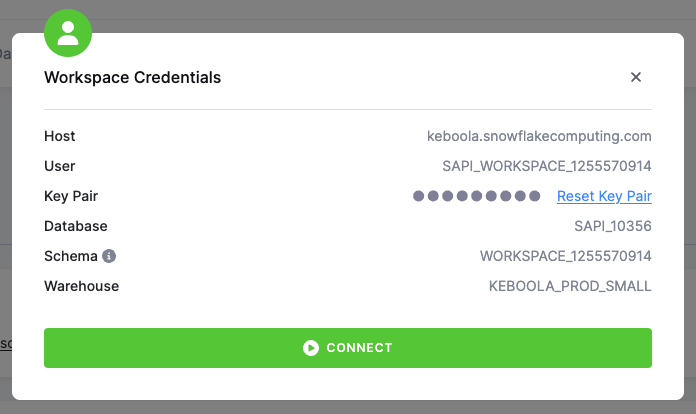
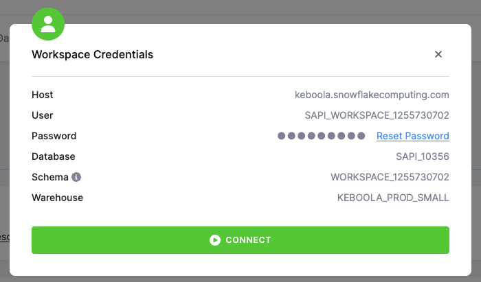
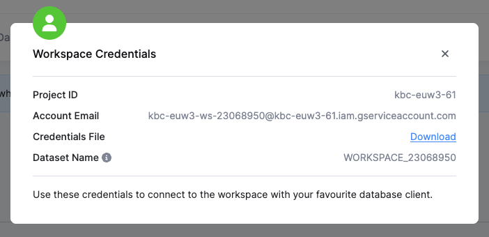

How to get into a workspace once it exists, by workspace type and by tool.

### Connecting to Workspace
#### Python/R
To connect to a [JupyterLab](https://jupyterlab.readthedocs.io/en/stable/) workspace with the associated kernel 
(Python, R), use the URL and the password provided in the **Credentials** link. Use the **Connect** button 
to directly open the JupyterLab interface.


#### SQL Editor

The built-in [SQL Editor](/workspace/sql-editor) lets you work with **Snowflake** and **Google BigQuery** workspaces directly in your browser, without connecting any external tools.

>***Note for Multi-tenant and Pay-As-You-Go Projects (Snowflake backend)***
>
>If your project uses Keboola's shared Snowflake backend (Multi-tenant or Pay-As-You-Go), the **SQL Editor is your primary tool** for SQL development, as direct Snowflake workspace access is not available.

:::tip[Use SQL Editor for Safe Testing]
For interactive SQL exploration inside your workspace, use the SQL Editor. It lets you safely test queries, preview data, and prepare the SQL code you later use in your transformations - without affecting your production pipelines. Learn more: [SQL Editor](/workspace/sql-editor).
:::

#### Keboola JDBC Driver

To query your project's data from external SQL clients and BI tools, use the [Keboola JDBC driver](/workspace/jdbc-driver/). It connects DBeaver, DataGrip, Tableau, or any JDBC-compatible client to your project through the Query Service API, with step-by-step installation guides for each.

#### Snowflake

We provide two versions of [Snowflake](https://www.snowflake.com/) workspaces with different authentication options for projects with dedicated Snowflake backends.

**Person** type workspace uses `SSO` and `Key Pair` authentication methods. To connect using:

- `SSO` - use the **Connect** button in the **Connect** menu to login to Snowflake's [Snowsight](https://docs.snowflake.com/en/user-guide/ui-snowsight-homepage) web interface.
- `Key Pair` - use your favorite database client or other third-party tool and the Key Pair credentials provided in the **Connect** menu. Keboola can generate the key pair for you, or you can [bring your own](#bringing-your-own-key-pair) and register only the public key.



**Legacy Service** type workspace uses `SSO` and `Password` authentication methods. To connect using:

- `SSO` - use the **Connect** button in the **Connect** menu to login to Snowflake's [Snowsight](https://docs.snowflake.com/en/user-guide/ui-snowsight-homepage) web interface.
- `Password` - use your favorite database client or other third-party tool and the Password credentials provided in the **Connect** menu.



>***Important***
>
>**Legacy Service** type workspace is using single-factor password authentication which is being [deprecated by Snowflake](https://docs.snowflake.com/en/user-guide/security-mfa-rollout).
>As a result, we are deprecating this login type by the end of 2025.
>We recommend using `Person` type workspace instead, if you don't need to use password authentication.

##### Using Key Pair Authentication with Third-Party Tools
Below are links to documentation for popular database IDEs used by Keboola users that support Key Pair authentication.

- [DBeaver Community Edition](https://community.snowflake.com/s/article/Using-Private-Key-authentication-in-DBeaver)
- [DBeaver Commercial Editions](https://dbeaver.com/docs/dbeaver/Authentication-Snowflake/#private-key-authentication)
- [DataGrip](https://www.jetbrains.com/help/datagrip/create-snowflake-data-source-with-key-pair-authentication.html)
- [VSCode/Cursor Snowflake Extension](https://docs.snowflake.com/en/user-guide/vscode-ext#sign-in-to-snowflake-with-the-vs-code-extension)
- [VSCode/Cursore DBCode Extension](https://dbcode.io/docs/supported-databases/snowflake)

##### Private Key Security and Encryption
When Keboola generates the key pair, the private key is unencrypted, so we recommend using password management tools like [Keepass](https://keepass.info/) or [1Password](https://1password.com/) to store your private key for better security.
In case you need to store the private key locally and want to protect it from unauthorized access, you can follow the instructions below based on your OS to encrypt it using [OpenSSL](https://www.openssl.org/):

If your tool requires a passphrase-protected private key, you can also [bring your own key pair](#bringing-your-own-key-pair) instead.

**macOS & Linux**

Open a terminal and run:

```
openssl pkcs8 -in private_key.pem -topk8 -v2 aes-256-cbc -out private_key_encrypted.pem
```

* `-in private_key.pem` → input file
* `-topk8` → outputs in PKCS #8 format
* `-v2 aes-256-cbc` → encryption algorithm
* `-out private_key_etncrypted.pem` → encrypted key file

👉 You’ll be prompted to set a password.

**Windows**

Make sure OpenSSL is installed (e.g., via [WSL](https://learn.microsoft.com/en-us/windows/wsl/install) or [Windows binaries](https://slproweb.com/products/Win32OpenSSL.html)).

Open PowerShell or Command Prompt and run:

```
openssl pkcs8 -in private_key.pem -topk8 -v2 aes-256-cbc -out private_key_encrypted.pem
```

* `-in private_key.pem` → input file
* `-topk8` → outputs in PKCS #8 format
* `-v2 aes-256-cbc` → encryption algorithm
* `-out private_key_encrypted.pem` → encrypted key file

👉 You’ll be prompted to set a password.

##### Bringing Your Own Key Pair
Some third-party tools (such as SAS CI360) require a passphrase-protected private key. Keboola only needs the public half of the pair, so you can create it yourself and register just the public key.

Generate the pair as follows (on Windows, with OpenSSL installed as described above). You'll be prompted to set a passphrase:

```
openssl genpkey -algorithm RSA -pkeyopt rsa_keygen_bits:2048 -aes-256-cbc -out private_key_encrypted.pem
openssl rsa -in private_key_encrypted.pem -pubout -out public_key.pem
```

To register the key, open the **Connect** menu on your workspace and use **Use Own Key** next to **Reset Key Pair**, then paste the contents of `public_key.pem` or drop the file onto the field. It must be an RSA key of at least 2048 bits, in PEM (`-----BEGIN PUBLIC KEY-----`) or base64-encoded DER format. Convert a PKCS #1 key with `openssl rsa -RSAPublicKey_in -in public_key.pem -pubout`, or an OpenSSH one with `ssh-keygen -e -m PKCS8 -f public_key.pub`.

:::caution
Registering a public key replaces the one currently on the workspace, so the previous key pair stops working immediately.
:::

##### Private Key Conversion to .p8 Format
Some third-party BI tools (such as Metabase) require private keys in `.p8` format instead of the default `.pem` format provided by Keboola. You can convert your private key using OpenSSL with the following command:

**macOS & Linux**

Open a terminal and run:

```
openssl pkcs8 -topk8 -inform PEM -outform DER -in private_key.pem -out private_key.p8 -nocrypt
```

* `-topk8` → outputs in PKCS #8 format
* `-inform PEM` → input format is PEM
* `-outform DER` → output format is DER
* `-in private_key.pem` → input file
* `-out private_key.p8` → output file
* `-nocrypt` → no encryption

**Windows**

Make sure OpenSSL is installed (e.g., via [WSL](https://learn.microsoft.com/en-us/windows/wsl/install) or [Windows binaries](https://slproweb.com/products/Win32OpenSSL.html)).

Open PowerShell or Command Prompt and run:

```
openssl pkcs8 -topk8 -inform PEM -outform DER -in private_key.pem -out private_key.p8 -nocrypt
```

* `-topk8` → outputs in PKCS #8 format
* `-inform PEM` → input format is PEM
* `-outform DER` → output format is DER
* `-in private_key.pem` → input file
* `-out private_key.p8` → output file
* `-nocrypt` → no encryption

#### BigQuery
To connect to a [BigQuery](https://cloud.google.com/bigquery) workspace with an external database client, use the **Credentials File** provided in the **Connect** menu. Alternatively, use the built-in [SQL Editor](/workspace/sql-editor) without any external tools.



**Next:** [SQL Editor →](/workspace/sql-editor/)
