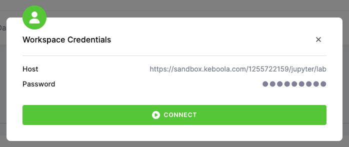

import { Tabs, TabItem } from '@astrojs/starlight/components';

This page shows how to open a [workspace](/workspace/) once it exists, by workspace type and by tool. If you have
no workspace yet, [create one](/workspace/create/) first.

{/* How-to-type page. Source: the former single Workspace page on main; split by type, text carried over, checked 2026-11-19. */}

## Connect to a workspace

**Goal:** the workspace open in the tool that fits it: JupyterLab, the SQL Editor, Snowsight, or your own SQL client.

Open the workspace detail, then follow the tab for your workspace type or tool:

<Tabs syncKey="workspace-connect">
  <TabItem label="Python/R">
    To connect to a [JupyterLab](https://jupyterlab.readthedocs.io/en/stable/) workspace with the associated kernel
    (Python, R), use the URL and the password provided in the **Credentials** link. Use the **Connect** button
    to directly open the JupyterLab interface.

    

    If JupyterLab shows a **Server Connection Error**, the workspace has been terminated. Go to the list of
    workspaces in Keboola, resume the workspace and reconnect from there.
  </TabItem>
  <TabItem label="SQL Editor">
    Click **Open SQL Editor** in the workspace detail.

    The built-in [SQL Editor](/workspace/sql-editor/) lets you work with **Snowflake** and **Google BigQuery** workspaces directly in your browser, without connecting any external tools.

    :::note[Multi-tenant and Pay-As-You-Go projects (Snowflake backend)]
    If your project uses Keboola's shared Snowflake backend (Multi-tenant or Pay-As-You-Go), the **SQL Editor is your primary tool** for SQL development, as direct Snowflake workspace access is not available.
    :::

    :::tip[Use SQL Editor for Safe Testing]
    For interactive SQL exploration inside your workspace, use the SQL Editor. It lets you safely test queries, preview data, and prepare the SQL code you later use in your transformations - without affecting your production pipelines. Learn more: [SQL Editor](/workspace/sql-editor/).
    :::
  </TabItem>
  <TabItem label="Snowflake">
    :::caution[Direct access needs a dedicated backend]
    Direct access to Snowflake workspaces is only available for projects with dedicated Snowflake backends.
    [Workspace types](/workspace/#snowflake) says which projects those are and what to use otherwise.
    :::

    We provide two versions of [Snowflake](https://www.snowflake.com/) workspaces with different authentication options for projects with dedicated Snowflake backends.

    **Person** type workspace uses `SSO` and `Key Pair` authentication methods. To connect using:

    - `SSO` - use the **Connect** button in the **Connect** menu to login to Snowflake's [Snowsight](https://docs.snowflake.com/en/user-guide/ui-snowsight-homepage) web interface.
    - `Key Pair` - use your favorite database client or other third-party tool and the Key Pair credentials provided in the **Connect** menu. Keboola can generate the key pair for you, or you can [bring your own](#bring-your-own-key-pair) and register only the public key.

    

    **Legacy Service** type workspace uses `SSO` and `Password` authentication methods. To connect using:

    - `SSO` - use the **Connect** button in the **Connect** menu to login to Snowflake's [Snowsight](https://docs.snowflake.com/en/user-guide/ui-snowsight-homepage) web interface.
    - `Password` - use your favorite database client or other third-party tool and the Password credentials provided in the **Connect** menu.

    

    :::caution[Important]
    **Legacy Service** type workspace is using single-factor password authentication which is being [deprecated by Snowflake](https://docs.snowflake.com/en/user-guide/security-mfa-rollout).
    As a result, we are deprecating this login type by the end of 2025.
    We recommend using `Person` type workspace instead, if you don't need to use password authentication.
    :::

    {/* VERIFY(Nikita): "by the end of 2025" has passed, and the access-changes page later moved the dates to 2026. Check whether Legacy Service workspaces can still be created and used, and update or remove this part. Evidence 2026-11-20: of the 25 workspaces in project 264, 21 use snowflake-service-keypair, 2 snowflake-person-sso and 2 none; none uses a password (Legacy Service) login. */}
  </TabItem>
  <TabItem label="BigQuery">
    To connect to a [BigQuery](https://cloud.google.com/bigquery) workspace with an external database client, use the **Credentials File** provided in the **Connect** menu. Alternatively, use the built-in [SQL Editor](/workspace/sql-editor/) without any external tools.

    
  </TabItem>
  <TabItem label="JDBC driver">
    To query your project's data from external SQL clients and BI tools, use the [Keboola JDBC driver](/workspace/jdbc-driver/). It connects DBeaver, DataGrip, Tableau, or any JDBC-compatible client to your project through the Query Service API, with step-by-step installation guides for each.
  </TabItem>
</Tabs>

**Result:** you are in the workspace. JupyterLab, the SQL Editor or Snowsight is open in your browser, or your client
is connected with the credentials from the **Connect** menu.

## Use a Snowflake key pair with your own tools

**Goal:** a database client or BI tool connected to a **Person** type Snowflake workspace with key-pair
authentication, with the private key in the form the tool needs.

1. Open the **Connect** menu on the workspace and take the Key Pair credentials. Keboola can generate the key pair
   for you.
   {/* VERIFY(Nikita): how the reader gets the private key file out of the Connect menu (download or copy), and the file name to expect. The commands below assume `private_key.pem`. */}
2. Get the private key into the form your tool needs. The options below are alternatives, not a sequence: each one
   starts from the unencrypted `private_key.pem` that Keboola generated.
   - The tool accepts a `.pem` key: store it in a password manager, or
     [encrypt it](#encrypt-the-private-key) if you keep it on disk.
   - The tool needs a `.p8` key: [convert it](#convert-the-private-key-to-p8-format). The `.p8` file is not encrypted.
   - The tool needs a passphrase-protected key: you can encrypt it as above, or
     [bring your own key pair](#bring-your-own-key-pair) instead.
3. Set up key-pair authentication in your tool. Below are links to documentation for popular database IDEs used by
   Keboola users that support Key Pair authentication.

   - [DBeaver Community Edition](https://community.snowflake.com/s/article/Using-Private-Key-authentication-in-DBeaver)
   - [DBeaver Commercial Editions](https://dbeaver.com/docs/dbeaver/Authentication-Snowflake/#private-key-authentication)
   - [DataGrip](https://www.jetbrains.com/help/datagrip/create-snowflake-data-source-with-key-pair-authentication.html)
   - [VSCode/Cursor Snowflake Extension](https://docs.snowflake.com/en/user-guide/vscode-ext#sign-in-to-snowflake-with-the-vs-code-extension)
   - [VSCode/Cursor DBCode Extension](https://dbcode.io/docs/supported-databases/snowflake)

   The **Connect** menu shows the values the tool needs besides the private key: **Host**, **User**, **Database**,
   **Schema** and **Warehouse**. Where the tool asks for an account identifier, use the Host without
   `.snowflakecomputing.com`. The menu shows no role, and you do not need to set one.
   {/* Checked 2026-11-20: fields from workspace-connect-snowflake-person.png; account derivation and no-role profile from the kbc CLI dbt generator (keboola-as-code pkg/lib/operation/dbt/generate). */}

**Result:** the tool connects to the workspace with the key pair.

### Encrypt the private key

When Keboola generates the key pair, the private key is unencrypted, so we recommend using password management tools like [Keepass](https://keepass.info/) or [1Password](https://1password.com/) to store your private key for better security.
In case you need to store the private key locally and want to protect it from unauthorized access, encrypt it using [OpenSSL](https://www.openssl.org/).

1. Open a terminal. On Windows, make sure OpenSSL is installed (e.g., via [WSL](https://learn.microsoft.com/en-us/windows/wsl/install) or [Windows binaries](https://slproweb.com/products/Win32OpenSSL.html)), and open PowerShell or Command Prompt.
2. Run:

   ```bash
   openssl pkcs8 -in private_key.pem -topk8 -v2 aes-256-cbc -out private_key_encrypted.pem
   ```

   * `-in private_key.pem` → input file
   * `-topk8` → outputs in PKCS #8 format
   * `-v2 aes-256-cbc` → encryption algorithm
   * `-out private_key_encrypted.pem` → encrypted key file

3. Set a password when you are prompted for it.

### Bring your own key pair

Some third-party tools (such as SAS CI360) require a passphrase-protected private key. Keboola only needs the public half of the pair, so you can create it yourself and register just the public key.

1. Generate the pair as follows (on Windows, with OpenSSL installed as described above). You'll be prompted to set a passphrase:

   ```bash
   openssl genpkey -algorithm RSA -pkeyopt rsa_keygen_bits:2048 -aes-256-cbc -out private_key_encrypted.pem
   openssl rsa -in private_key_encrypted.pem -pubout -out public_key.pem
   ```

2. To register the key, open the **Connect** menu on your workspace and use **Use Own Key** next to **Reset Key Pair**, then paste the contents of `public_key.pem` or drop the file onto the field.

The key must be an RSA key of at least 2048 bits, in PEM (`-----BEGIN PUBLIC KEY-----`) or base64-encoded DER format. Convert a PKCS #1 key with `openssl rsa -RSAPublicKey_in -in public_key.pem -pubout`, or an OpenSSH one with `ssh-keygen -e -m PKCS8 -f public_key.pub`.

:::caution
Registering a public key replaces the one currently on the workspace, so the previous key pair stops working immediately.
:::

### Convert the private key to .p8 format

Some third-party BI tools (such as Metabase) require private keys in `.p8` format instead of the default `.pem` format provided by Keboola. You can convert your private key using OpenSSL.

1. Open a terminal. On Windows, make sure OpenSSL is installed (e.g., via [WSL](https://learn.microsoft.com/en-us/windows/wsl/install) or [Windows binaries](https://slproweb.com/products/Win32OpenSSL.html)), and open PowerShell or Command Prompt.
2. Run:

   ```bash
   openssl pkcs8 -topk8 -inform PEM -outform DER -in private_key.pem -out private_key.p8 -nocrypt
   ```

   * `-topk8` → outputs in PKCS #8 format
   * `-inform PEM` → input format is PEM
   * `-outform DER` → output format is DER
   * `-in private_key.pem` → input file
   * `-out private_key.p8` → output file
   * `-nocrypt` → no encryption

**Next:** [SQL Editor →](/workspace/sql-editor/)
