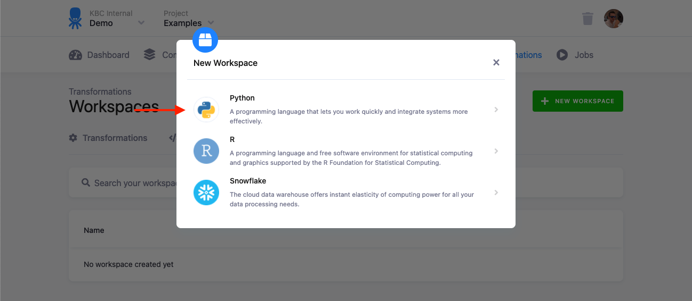
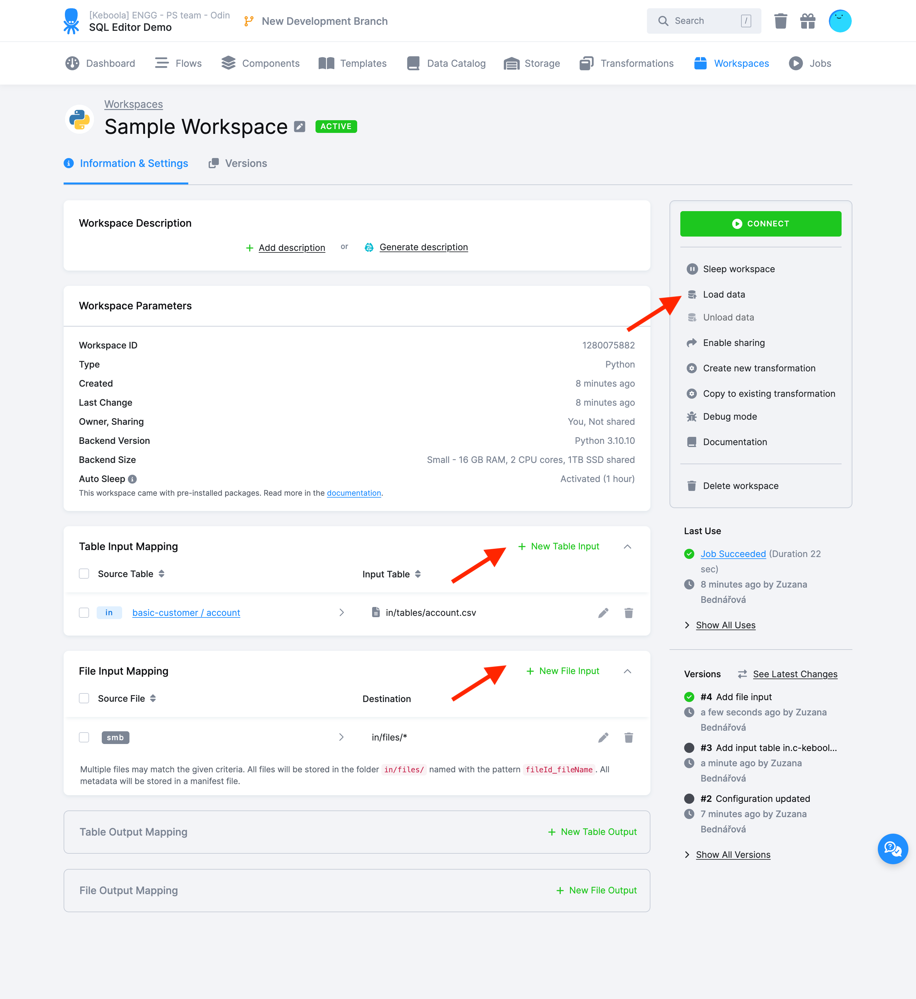
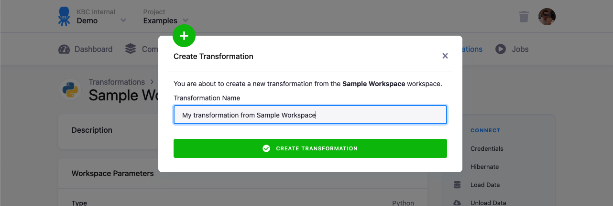

Step-by-step tasks for a workspace, from creating it to moving its results back to Storage.

## Working with Workspaces
Select from the top menu Workspaces:

Name and optionally describe the workspace:

Creating the workspace takes a few seconds, so it will take a while before it appears:

Once the workspace is ready, you'll see it in the workspace list:

In the workspace detail, you can

- get credentials & connect to the workspace,
- configure workspace [mappings](/transformations/mappings/),
- load & unload data specified in the mappings, and
- manage the workspace (resume & terminate & delete).

### Loading Data
To load arbitrary data into the workspace, configure a
[table input mapping](/transformations/mappings/#table-input-mapping) or
[file input mapping](/transformations/mappings/#file-input-mapping) (or both) and click the **Load Data** button.

When loading data, you have the option to **Clean workspace before loading**. When this option is enabled, Keboola removes all **tables** and **views** from the workspace schema before loading the new data. However, the following objects are **not** removed and will persist across loads:

- **Stored procedures**
- **User-defined functions (UDFs)**

This is by design — Keboola does not create stored procedures or UDFs, so it does not manage or remove them during cleanup. If you have created stored procedures or UDFs in the workspace, you are responsible for managing their lifecycle. Keep this in mind to avoid potential naming conflicts or unexpected behavior from outdated routines.

When loading data into a workspace, you can specify entire buckets, which can be especially
useful when you are not sure what tables you'll need in your work. You can also take
advantage of [alias tables](/storage/tables/#aliases) and prepare buckets with the tables you'll need.

### Unloading Data
You can also unload data from the Python and R workspaces. To unload data, configure 
[Table Output Mapping](/transformations/mappings/#table-output-mapping)
or [File Output Mapping](/transformations/mappings/#file-output-mapping) (or both) and click **Unload Data** button.

Unloading data is useful, for example, when your ad-hoc analysis leads to
valuable results, or when you trained a new model which you'd like to use in transformations.

For Snowflake and BigQuery workspaces, you can also export a single table directly from the workspace schema to
[File Storage](/storage/files/) via the Storage API. See
[Exporting Workspace Tables to Files](/workspace/table-export/) for details.

Snowflake and BigQuery workspaces can also skip unloading entirely and write to a Storage table directly with
[Direct Mode output mapping](/transformations/mappings/#direct-mode-output-mapping). The workspace gets write
access to the selected table as soon as the mapping is saved, so no **Unload Data** run is needed.

## Developing Transformations
Workspaces are highly useful for developing transformations. When you configure [mappings](/transformations/mappings/) 
and develop a script in JupyterLab, you can use the **Create Transformation** button to 
deploy the notebook into a transformation. Please note that only input/output mapping without the actual script is copied when creating transformation from a workspace

Enter the name of the new transformation:

You can also create workspaces from transformations.

**Next:** [Connect to a workspace →](/workspace/connect/)
