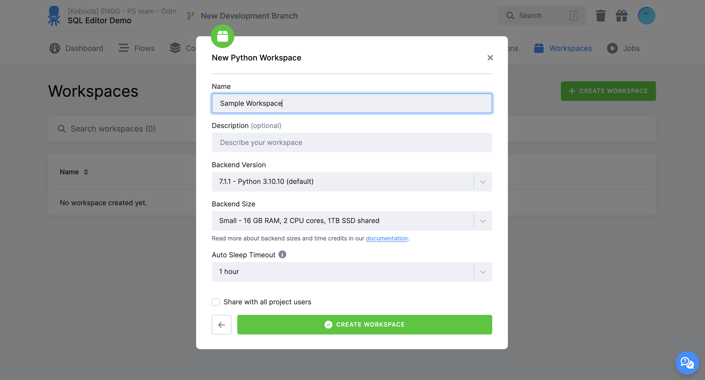
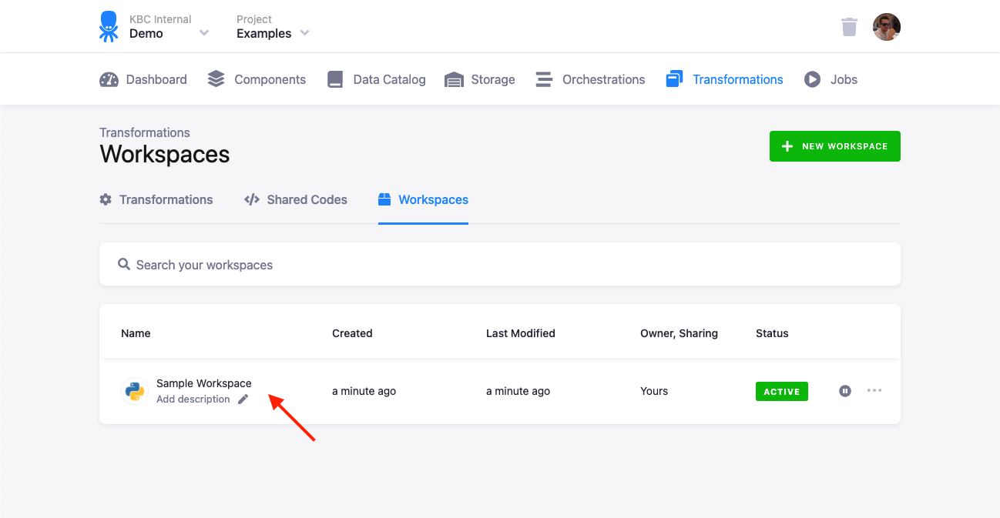
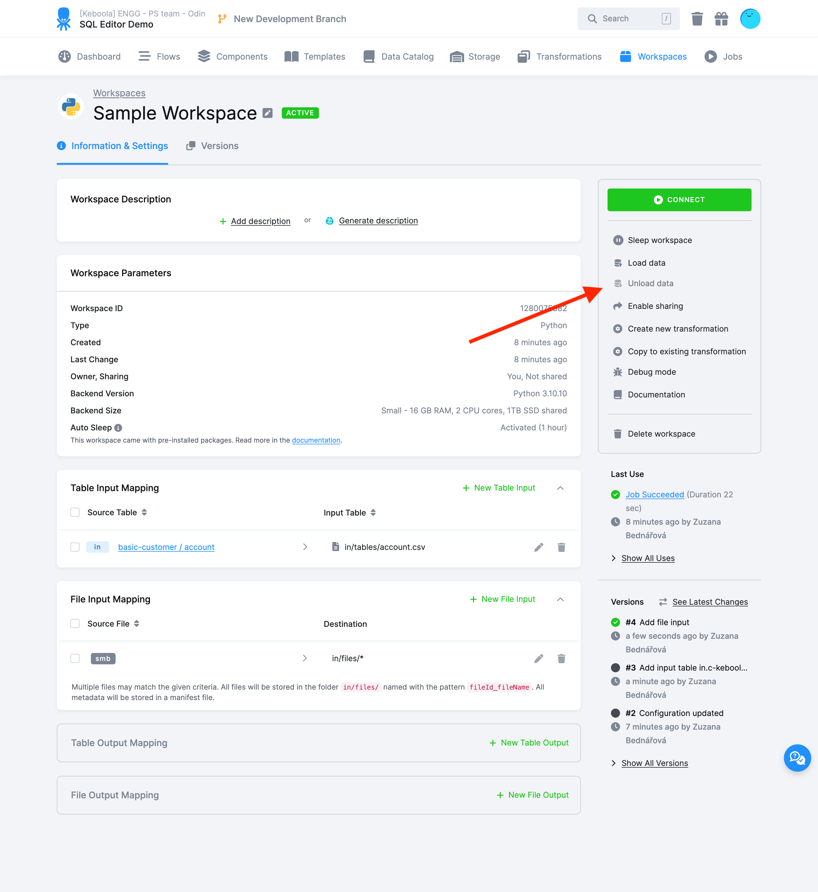
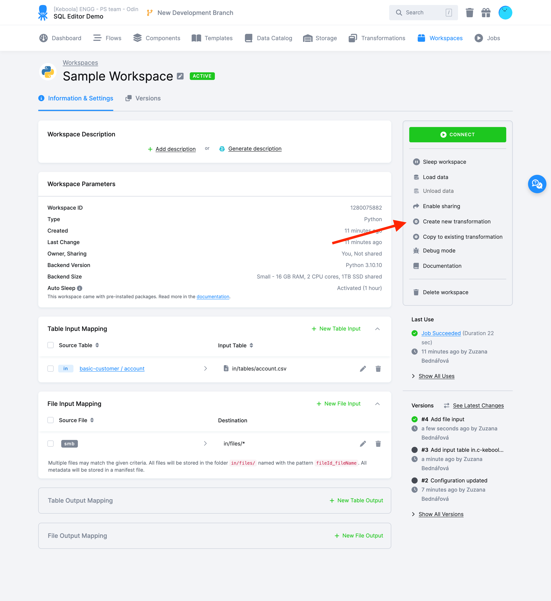

This page has the step-by-step tasks for a [workspace](/workspace/), from creating it to moving its results back to
Storage. To open the workspace in JupyterLab or a SQL tool, see [Connect to a workspace](/workspace/connect/).

<!-- How-to-type page. Source: the former single Workspace page on main; split by type, text carried over, checked 2026-11-19. -->

## Create a workspace

**Goal:** a running workspace of the type you need, listed in the **Workspaces** section.

1. Select **Workspaces** from the top menu and click **+ Create Workspace**.

   

2. Select a workspace type. Which types you can pick depends on the project; see
   [Workspace types](/workspace/#workspace-types).

   

3. Name and optionally describe the workspace. Where the dialog offers **Grant read-only access to all storage
   data**, ticking it enables [read-only input mapping](/workspace/#read-only-input-mapping).

   

   <!-- VERIFY(Nikita): the steps skip the submit button and the fields the screenshot shows (Backend Version, Backend Size, Auto Sleep Timeout, Share with all project users). Check the current dialog and name the button and the fields a reader has to set. -->

Creating the workspace takes a few seconds, so it will take a while before it appears:

**Result:** once the workspace is ready, you'll see it in the workspace list:

In the workspace detail, you can

- get credentials & [connect to the workspace](/workspace/connect/),
- configure workspace [mappings](/transformations/mappings/),
- load & unload data specified in the mappings, and
- manage the workspace (resume & terminate & delete).

You can also create workspaces from transformations.

## Load data into a workspace

**Goal:** the Storage tables and files you need, available inside the workspace.

<!-- VERIFY(Nikita): how to open the workspace detail (click the name in the Workspaces list?), and where the Clean workspace before loading option sits (in the Load data dialog?). The tasks on this page start from the detail and do not say how to get there. -->

1. In the workspace detail, configure a
   [table input mapping](/transformations/mappings/#table-input-mapping) or
   [file input mapping](/transformations/mappings/#file-input-mapping) (or both).
2. Click the **Load Data** button.

   

When loading data into a workspace, you can specify entire buckets, which can be especially
useful when you are not sure what tables you'll need in your work. You can also take
advantage of [alias tables](/storage/tables/#aliases) and prepare buckets with the tables you'll need.

**Result:** the tables and files from the input mapping are loaded into the workspace.

### Clean workspace before loading

When loading data, you have the option to **Clean workspace before loading**. When this option is enabled, Keboola removes all **tables** and **views** from the workspace schema before loading the new data. However, the following objects are **not** removed and will persist across loads:

- **Stored procedures**
- **User-defined functions (UDFs)**

This is by design — Keboola does not create stored procedures or UDFs, so it does not manage or remove them during cleanup. If you have created stored procedures or UDFs in the workspace, you are responsible for managing their lifecycle. Keep this in mind to avoid potential naming conflicts or unexpected behavior from outdated routines.

## Unload data from a workspace

**Goal:** tables or files from a Python or R workspace saved to Storage.

Unloading data is useful, for example, when your ad-hoc analysis leads to
valuable results, or when you trained a new model which you'd like to use in transformations.

1. In the workspace detail, configure a
   [Table Output Mapping](/transformations/mappings/#table-output-mapping)
   or [File Output Mapping](/transformations/mappings/#file-output-mapping) (or both).
2. Click the **Unload Data** button.

   

**Result:** the tables and files from the output mapping are saved to Storage.

For Snowflake and BigQuery workspaces, you can also export a single table directly from the workspace schema to
[File Storage](/storage/files/) via the Storage API. See
[Exporting Workspace Tables to Files](/workspace/table-export/) for details.

Snowflake and BigQuery workspaces can also skip unloading entirely and write to a Storage table directly with
[Direct Mode output mapping](/transformations/mappings/#direct-mode-output-mapping). The workspace gets write
access to the selected table as soon as the mapping is saved, so no **Unload Data** run is needed.

## Create a transformation from a workspace

**Goal:** a new transformation that carries the input and output mapping of the workspace.

<!-- VERIFY(Nikita): this task assumes a JupyterLab (Python or R) workspace. Check whether SQL workspaces offer the same action, and say so either way. -->

1. Configure [mappings](/transformations/mappings/) and develop a script in JupyterLab.
2. In the workspace detail, use the **Create Transformation** button to deploy the notebook into a transformation.

   

3. Enter the name of the new transformation:

   

**Result:** a new transformation. Please note that only input/output mapping without the actual script is
copied when creating transformation from a workspace.
<!-- VERIFY(Nikita): the screenshot shows this action as "Create new transformation", next to "Copy to existing transformation". Check the current label, and whether the script really stays behind. Three pages disagree on what moves to the transformation: here only the mappings, not the script; sql-editor/use says Save Queries creates a transformation with the SQL code and the output mapping; sql-editor/ says you save, then copy to a new or existing transformation, which transfers the queries, mappings and variables. -->

**Next:** [Connect to a workspace →](/workspace/connect/)
