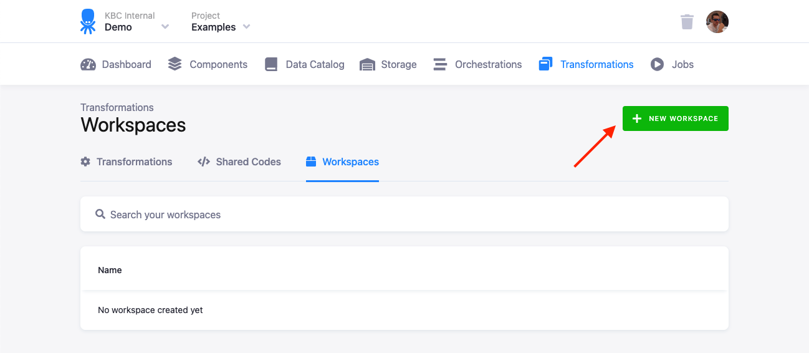
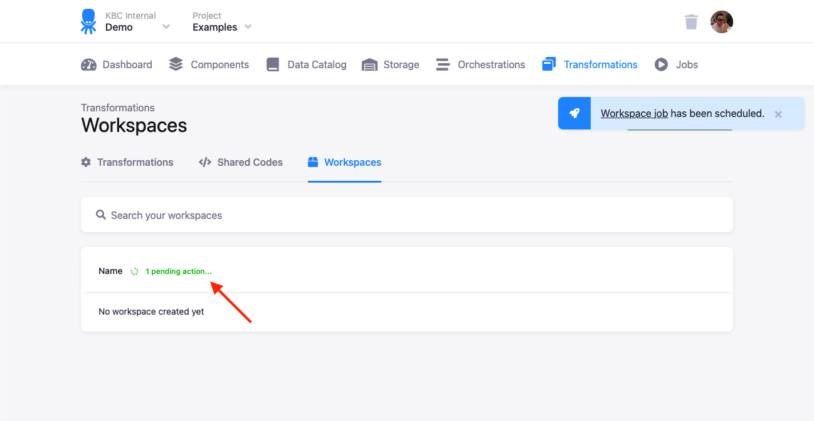

This page has the step-by-step tasks for a [workspace](/workspace/), from creating it to moving its results back to
Storage. To open the workspace in JupyterLab or a SQL tool, see [Connect to a workspace](/workspace/connect/).

<!-- How-to-type page. Source: the former single Workspace page on main; split by type, text carried over, checked 2026-11-19. -->

## Create a workspace

**Goal:** a running workspace of the type you need, listed in the **Workspaces** section.

1. Select **Workspaces** from the top menu and click **+ Create Workspace**.

   

2. Select a workspace type. Which types you can pick depends on the project; see
   [Workspace types](/workspace/#workspace-types).

   

3. Enter a **Name** and, optionally, a **Description**. The other fields depend on the workspace type and come
   with a default: a Python or R workspace has **Backend Version**, **Backend Size**, **Auto Sleep Timeout** and
   **Share with all project users**; a Snowflake SQL workspace has **Folder** and **Share with all project users**, and no choice of authentication.
   <!-- Checked 2026-11-20 in the UI of project 264: the New Snowflake SQL Workspace form had Name, Description, Folder, Share with all project users and Create Workspace. VERIFY(Nikita): whether projects with dynamic backends also show Backend Size there. -->
   Where the dialog offers **Grant read-only access to all storage data**, ticking it enables
   [read-only input mapping](/workspace/#read-only-input-mapping); where it shows a **Read-Only Access** note
   instead, the workspace gets read-only access to all project data by default.

   

4. Click **Create Workspace**.

<!-- Checked 2026-11-20: field and button names from workspace-create-2.png and sql-editor/02-create-workspace-action.jpg. -->

Creating the workspace takes a few seconds, so it will take a while before it appears:

**Result:** once the workspace is ready, you'll see it in the workspace list:

In the workspace detail, you can

- get credentials & [connect to the workspace](/workspace/connect/),
- configure workspace [mappings](/transformations/mappings/),
- load & unload data specified in the mappings, and
- manage the workspace (resume & terminate & delete).

You can also create workspaces from transformations.

## Load data into a workspace

**Goal:** the Storage tables and files you need, available inside the workspace.

To open the workspace detail, click the workspace name in the **Workspaces** list.

1. In the workspace detail, configure a
   [table input mapping](/transformations/mappings/input/#table-input-mapping) or
   [file input mapping](/transformations/mappings/input/#file-input-mapping) (or both).
2. In the right panel, click **Load data**. It is enabled only when the workspace has an input mapping.

   

3. In the **Load Data to Workspace** dialog, choose the **Operation**: **Preserve non-conflicting tables** or
   **Clean workspace before loading** (the default). Click **Load data**.
   <!-- Checked 2026-11-20 in the UI of project 264: right panel Load data (enabled only with an input mapping) opens the dialog Load Data to Workspace; Operation: Preserve non-conflicting tables / Clean workspace before loading (default); button Load data. -->

When loading data into a workspace, you can specify entire buckets, which can be especially
useful when you are not sure what tables you'll need in your work. You can also take
advantage of [alias tables](/storage/tables/#aliases) and prepare buckets with the tables you'll need.

**Result:** the tables and files from the input mapping are loaded into the workspace.

### Clean workspace before loading

In the **Load Data to Workspace** dialog, you have the option to **Clean workspace before loading**. When this option is enabled, Keboola removes all **tables** and **views** from the workspace schema before loading the new data. However, the following objects are **not** removed and will persist across loads:

- **Stored procedures**
- **User-defined functions (UDFs)**

This is by design — Keboola does not create stored procedures or UDFs, so it does not manage or remove them during cleanup. If you have created stored procedures or UDFs in the workspace, you are responsible for managing their lifecycle. Keep this in mind to avoid potential naming conflicts or unexpected behavior from outdated routines.

## Unload data from a workspace

**Goal:** tables or files from a Python or R workspace saved to Storage.

Unloading data is useful, for example, when your ad-hoc analysis leads to
valuable results, or when you trained a new model which you'd like to use in transformations.

1. In the workspace detail, configure a
   [Table Output Mapping](/transformations/mappings/output/#table-output-mapping)
   or [File Output Mapping](/transformations/mappings/output/#file-output-mapping) (or both).
2. Click **Unload data**.

   

**Result:** the tables and files from the output mapping are saved to Storage.

For Snowflake and BigQuery workspaces, you can also export a single table directly from the workspace schema to
[File Storage](/storage/files/) via the Storage API. See
[Exporting Workspace Tables to Files](/workspace/table-export/) for details.

Snowflake and BigQuery workspaces can also skip unloading entirely and write to a Storage table directly with
[Direct Mode output mapping](/transformations/mappings/direct-mode/). The workspace gets write
access to the selected table as soon as the mapping is saved, so no **Unload data** run is needed.

## Create a transformation from a workspace

**Goal:** a new transformation that carries the input and output mapping of the workspace.

Python and Snowflake SQL workspaces both have this action in the workspace detail.
<!-- Checked 2026-11-20: actions shown for Python (create-transformation-1.png) and Snowflake (sql-editor/03-workspace-details-open-editor.jpg); R and BigQuery not pictured. -->

1. Configure [mappings](/transformations/mappings/) and develop your script in JupyterLab or your queries in the
   [SQL Editor](/workspace/sql-editor/).
2. In the workspace detail, click **Create new transformation**. To add the workspace to a transformation you
   already have, click **Copy to existing transformation** instead.

   

3. In the **Create Transformation** dialog, enter the **Name** and optionally a **Description**; for a
   Python workspace, the name is prefilled with the workspace name and you can pick a **Backend Version**. Click **Create Transformation**.

   

**Result:** a new transformation with the input and output mapping of the workspace. From a Python or R workspace,
the notebook script is not copied. From an SQL workspace, the saved queries and variables are copied as well; see
[Variables](/workspace/sql-editor/#variables).
<!-- Checked 2026-11-20 in the UI of project 264, Snowflake and Python (temporary workspaces): the Python dialog adds Backend Version (optional, default Python 3.10.10); otherwise dialog Create Transformation ("You are about to create a new transformation from the workspace …"), fields Name* and Description (optional), button Create Transformation. VERIFY(Nikita): the dialog does not say what is copied; confirm the "notebook script is not copied" rule for Python/R (the Python dialog does not say either). -->

**Next:** [Connect to a workspace →](/workspace/connect/)
