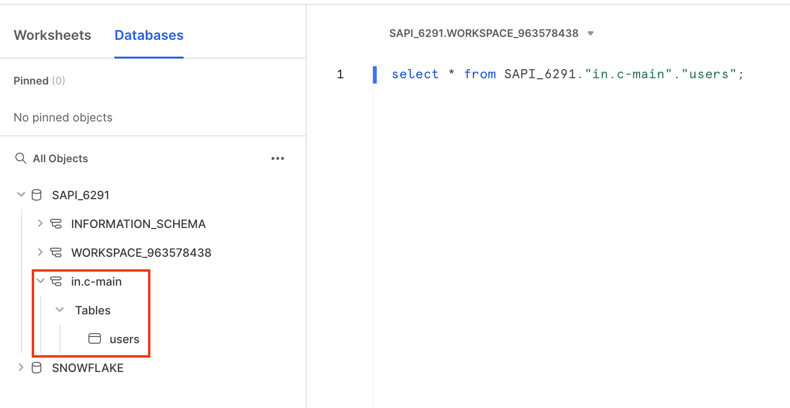
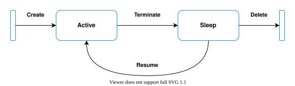

A workspace is a safe, isolated environment for working with your project's data: JupyterLab for Python and R, or SQL on
Snowflake and BigQuery. This page explains what workspaces are for, the workspace types and the workspace lifecycle. For
the steps, start with [Create a workspace and load data](/workspace/create/).

<!-- Explanation-type page. Source: the former single Workspace page on main; split by type, text carried over, checked 2026-11-19. -->

## What a workspace is for

A workspace serves several purposes and can be used as

- an *interactive development environment* (IDE) to create transformations. 
- an *analytical workspace* where you can interactively perform experiments and modelling with live production data. 
- an ephemeral workspace created on each run of a transformation to provide the *staging* area in which the transformation operates.

Ephemeral transformation workspaces are not visible in the transformation UI, hence we won't mention them further.

When the code you developed in a workspace works, you can
[create a transformation from the workspace](/workspace/create/#create-a-transformation-from-a-workspace).

## Analytical workspaces
Apart from developing transformations, you can use workspaces to perform ad-hoc analysis 
of production data of your choice. A workspace provides you with a safe and isolated environment
where you can experiment. The input mapping isolation also means that you can work on live
production projects without data in the workspace constantly changing — you update them
on demand by loading data into the workspace.

A comprehensive [video guide](https://www.youtube.com/watch?v=iQMnh9nqRiE) on this subject is available on our YouTube channel.

## Workspace types

Not all workspace types are supported in all projects. Workspace types match available transformation types.
How to open each type is in [Connect to a workspace](/workspace/connect/).

### Python and R

For scripting languages ([Python](https://www.python.org/) and 
[R](https://www.r-project.org/)), we provide [JupyterLab](https://jupyter.org/) with 
the matching [kernel](https://jupyter.readthedocs.io/en/latest/projects/kernels.html).

### Snowflake

For SQL workspaces, you can either use Snowflake's [Snowsight](https://docs.snowflake.com/en/user-guide/ui-snowsight-homepage) 
or a database client of your liking (for example, [DBeaver](https://dbeaver.io/)). The built-in
[SQL Editor](/workspace/sql-editor/) runs in your browser and needs no external tool.

:::caution[Direct access availability]
Direct access to Snowflake Workspaces is **only available for projects with dedicated Snowflake backends** (KBDB - Keboola-Brings-Database or BYODB - Bring-Your-Own-Database).

**Multi-tenant and Pay-As-You-Go projects** using Keboola's shared Snowflake backend **do not have direct access** to Snowflake Workspaces.
For these projects, use these alternatives:
- **[SQL Editor](/workspace/sql-editor/)** - for interactive SQL queries, transformations, and development
- **[Data Gateway](/components/applications/data-gateway/)** - for connecting BI tools and external applications
:::

Projects with a dedicated Snowflake backend get two versions of the Snowflake workspace, **Person** and
**Legacy Service**. They differ in how you sign in; both are described in
[Connect to a workspace](/workspace/connect/).
<!-- VERIFY(Nikita): the Connect page carries a marker on the Legacy Service deprecation date. If Legacy Service workspaces are gone, drop them here as well. Evidence 2026-11-20: of the 25 workspaces in project 264, 21 use snowflake-service-keypair, 2 snowflake-person-sso and 2 none; none uses a password (Legacy Service) login. -->

### BigQuery

A BigQuery workspace opens in the built-in [SQL Editor](/workspace/sql-editor/), or in an external database client
with the credentials file from the workspace. See [Connect to a workspace](/workspace/connect/).

## Read-only input mapping

The workspace also supports **read-only input mappings**, as described in the [mapping section](/transformations/mappings/input/#read-only-input-mapping).
For each **workspace** or **Snowflake writer** (data destination) configuration, users can choose whether to use a **read-only input mapping**.

Note that **there are security implications**. If you enable a **read-only input mapping** for a workspace, then it has access to all the data in the project. 
You may not want to share workspace credentials with other people unless it's acceptable for them to see all the data in the project. If limited access is required, do not enable **read-only input mappings** for the workspace.

With **read-only input mappings** disabled, only tables listed in the input mapping are accessible.

So, if we enable this feature when we create a workspace, we can access individual tables in the workspace,
without needing to define any tables in the input mapping. Alias tables are materialized as database VIEWs and are fully accessible via read-only input mappings — including filtered aliases.
This also applies to linked buckets. Note that buckets and tables belong to another project, so you must access, for example, the database of another project depending on the backend.
For example, say your bucket `in.c-customers` is linked from bucket `in.c-crm-extractor` in project 123. You then need to reference the tables in the transformation like this: `"KEBOOLA_123"."in.c-crm-extractor"."my-table"`. When developing transformation code, it's easiest to create a workspace with **read-only input mappings** enabled and look directly in the database to find the correct database and schema names. 

## Workspace lifecycle
When a workspace is created, it enters the **Active** state and can be used. 

- Database (Snowflake and BigQuery) workspaces are billed by the runtime of queries executed in them. They stay active until you delete them, unless nobody uses them for six months; such workspaces are first warned, then deactivated and later deleted automatically, see [Workspace Retention](/workspace/retention/).
- JupyterLab workspaces are billed by their running time. They can be terminated and resumed, in order to reduce running time while preserving your work. 

The diagram does not show the **Deactivated** state that retention introduces for Snowflake and BigQuery
workspaces; see [Workspace Retention](/workspace/retention/).

Workspace termination can be done manually or it is done automatically after 1 hour period of inactivity (if auto sleep feature is supported and enabled). 
Inactivity is measured from the last save of any notebook in JupyterLab. When a workspace is terminated, it is switched off
and consumes no credits. A terminated workspace can be resumed. Resuming a workspace means that we restore the
last saved version of all notebooks in the home directory (`/data`). We also load the current data from Input Mapping.

On a restored workspace, you'll get

- all notebook files with their results,
- the current version of input mapping sources (beware that these might have changed in the mean time)
- new password
- Git configuration (if it was initialized before the termination)

Terminating and restoring a workspace means that you'll loose

- the contents of memory,
- state of the notebook executions (the results are preserved however), and
- modifications to any data or temporary files on the local workspace drive.

*Note: When you terminate and restore the workspace, its password changes.*

When a workspace is terminated and you return to the JupyterLab interface (e.g., when you put your computer to sleep), 
you'll see the following error:

    Server Connection Error
    A connection to the Jupyter server could not be established. JupyterLab will continue trying to reconnect. Check your network connection or Jupyter server configuration.

The workspace is still there. How to resume it and get back in is in
[Connect to a workspace](/workspace/connect/).

## Data persistency (beta)
When this feature is enabled in a project, your data in workspaces can be kept. This way you can, when you return, start where you left off without losing data or time by importing the data again or executing scripts to get to the right stage.

Once this feature is activated, we will automatically back up all the data in newly created workspaces up to the limits defined by your selected workspace size. More specifically:
- Small (50 GB), medium (100 GB), and large (150 GB)
- Everything in the /data folder will be kept.
- Auto-save (backup) of notebooks is disabled.
- Input-mapping is performed automatically only once, when the workspace is created, not when a workspace resumes.

Nothing changes for workspaces created before the feature was activated. Your data will be lost upon leaving the workspace. 
Workspaces created following the feature's deactivation will not keep their data when you leave.
However, if a workspace is created while the feature is activated, it will keep its data even after the feature is deactivated. Your data will be kept until the workspace is deleted.

Provisioning of persistent storage takes some time, usually 2–3 minutes after the feature is activated. To prevent workspaces that are begun in the meantime from becoming broken, we block their initiation until the storage is ready to be used.

Pricing:
Curently for FREE in public beta. When it is generally available, additional charges will apply. 
<!-- VERIFY(Nikita): is Data Persistency still a free public beta, and are the size limits (50, 100 and 150 GB) current? -->

## This section

The pages read in order:

1. [Create a workspace and load data](/workspace/create/) has the steps for a new workspace: creating it, loading tables and files, unloading the results, and turning it into a transformation.
2. [Connect to a workspace](/workspace/connect/) shows how to open JupyterLab, the SQL Editor, Snowsight or your own SQL client, and how to set up Snowflake key-pair authentication.
3. [SQL Editor](/workspace/sql-editor/) explains the in-browser editor: its interface, sessions, variables and sharing.
4. [Use the SQL Editor](/workspace/sql-editor/use/) has the editor's tasks, from running a query to saving your queries as a transformation.
5. [Keboola JDBC driver](/workspace/jdbc-driver/) connects DBeaver, DataGrip, Tableau or any other JDBC client to the project.
6. [Exporting workspace tables to files](/workspace/table-export/) is the reference for the Storage API call that writes a workspace table to File Storage.
7. [Workspace retention](/workspace/retention/) says when unused Snowflake and BigQuery workspaces are warned, deactivated and deleted.
8. [Snowflake workspaces access changes](/workspace/snowflake-workspaces-access-changes/) lists the dated changes to direct Snowflake access and password authentication.

**Next:** [Create a workspace and load data →](/workspace/create/)
