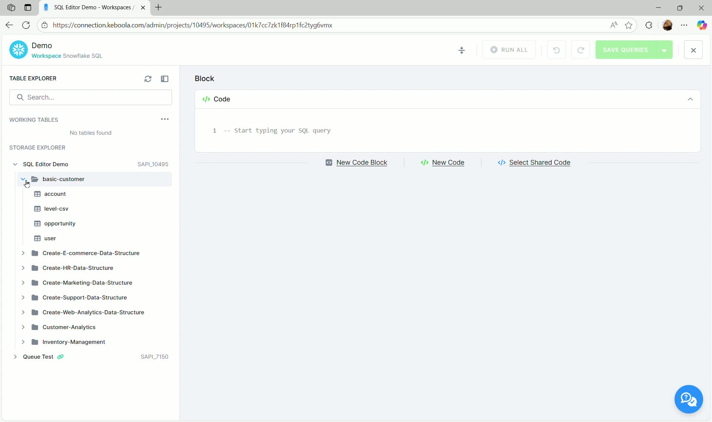

The Keboola SQL Editor allows users without specialized tools to directly interact with their data warehouse within Keboola Connection. It offers a smooth, fully integrated experience, replacing previous solutions like Snowsight. The editor is tightly connected with Keboola Storage, so you can easily access and use your buckets, tables, shared codes and variables in one place.

Currently, the SQL Editor supports **Snowflake** and **Google BigQuery** workspaces.

## SQL Editor Interface Overview

The SQL Editor interface is divided into key sections that make it easy to explore data, write queries, and create transformations directly within Keboola.

### Left Pane: Table Explorer

The left pane, known as the Table Explorer, is divided into two sections:

1.  **Working Tables**: Displays temporary tables created during your current session (initially empty).
2.  **Storage Explorer**: Allows you to browse all tables and buckets available in your Keboola project.

*   **Buckets and Tables**: The explorer shows buckets (folders) and the tables they contain. You can expand buckets to see tables (e.g., `account`, `user`).

*   **Linked Tables**: Linked buckets and tables (shared with you from other projects) are also visible, indicated by a small chain icon.

### Right Pane: Code Blocks and Results

The main central area is where you write and execute your SQL code.

*   **Code Block**: This is where you write your SQL queries. The editor supports syntax highlighting and autocompletion for SQL keywords and functions of your backend (Snowflake or BigQuery). 
*   **Query Result Pane**: Located below the code block, this area displays the results of executed queries and query details.

### Sessions in SQL Editor

A session allows multiple queries to share context and state, so you can work step by step instead of everything being completely independent.
Think of a session as a temporary working environment that exists while you’re actively working in the editor.

#### How long does a session last?

A session in the SQL Editor lasts for 24 hours when there is no user activity (e.g. running a query) or when SQL Editor is closed.

#### What happens when a session expires?
*   Temporary tables are removed
*   Session variables are cleared
*   Other session-specific state is lost

Your SQL queries themselves are not lost, but anything that depended on the previous session state will no longer work until it is recreated.
If your browser window stays open past the 24-hour limit, you’ll see a message informing you that the session has expired. 

#### SQL features that depend on sessions
*   Temporary tables (e.g. CREATE TEMP TABLE)
*   Temporary views
*   SQL variables
*   Session parameters
*   Multi-step workflows that assume shared state between queries

### Variables

Variables allow you to parametrize transformations. For how they work, see [Variables](/components/variables/).
Variables can be created, edited, used or removed inside of SQL Editor.

#### Using Variables in Transformations and Workspaces

Variables behave consistently across both Workspaces and Transformations:

In a Workspace, you can create variables and use them in your SQL queries. When you save the Workspace (which also saves its queries), you can then copy it to a new or existing Transformation. This action transfers the queries, input/output mapping, and all associated variables.

In a Transformation, you can also create variables and reference them in your transformation queries. You can then copy the Transformation to a Workspace, which brings over its queries, mappings, and variables.

#### Important ####

Variables are not shared automatically between Workspaces and Transformations.
If you create a variable in either a Workspace or a Transformation and do not copy the configuration to the other environment, that variable will remain local to where it was created—meaning it won’t be visible or usable elsewhere.

### Workspace Sharing

How Workspaces work now while using SQL Editor, there are two important components:
1. Workspace
   
This stores configuration - such as:
*   Input Mapping (IM)
*   Output Mapping (OM)
*   **Saved** SQL queries
2. Working Tables

This is the state of the database schema where tables are created while working in the workspace. Every user has his own.

**Previous Behavior (before SQL Editor):**
One workspace sandbox had one shared physical workspace for all users.
Multiple users worked in the same database schema, meaning:
*   They could see each other's tables.
*   They could accidentally overwrite or remove each other’s data.
Workspaces were hidden in the UI unless explicitly shared, but technically everyone still accessed the same workspace behind the scenes.

**Current Behavior (SQL Editor Workspaces):**
Each user now gets their own physical workspace (database schema) even though the sandbox configuration is shared.
This makes collaboration safer because:
*   Users share saved SQL queries, input/output mappings, and configuration.
*   But do NOT share query result tables or loaded data.
Everyone works in an isolated database state.

#### What This Means in Practice

| Scenario | What Happens | Impact |
|---|---|---|
| Two users open the same shared workspace sandbox | They see the same configuration (Input/Output mapping, saved SQL queries) | ✅ Collaboration on queries and configuration |
| User creates a table by running a query (not output-mapped) | Table is created only in that user’s personal database schema | ❌ Other users **cannot** see or access it |
| User saves an SQL query | Query is saved to the shared workspace sandbox configuration | ✅ Other users **can see and run it** |
| Two users save queries at the same time | A conflict warning appears (configuration changed by another user) | ⚠️ One user may need to reload/resolve changes |
| User unloads table from SQL Editor to Storage | Table becomes a standard KBC Storage table | ✅ Visible to others via Storage, outside the workspace |
| Sharing workspace sandbox is enabled | Users can open each other’s workspace sandbox configuration | ✅ Shared queries & mappings, ❌ not shared database state |

**Benefits of the New Setup**
*   Safer collaboration – users don’t overwrite each other’s data
*   SQL queries can be shared without entering the database (unlike before)
*   No risk of table conflicts when multiple people work in parallel
*   Query results can now be exported to Storage (previously not possible)
*   Same configuration, personal workspace state = best of both isolation and collaboration

**Limitations to Be Aware Of**
*   Users cannot directly share tables or workspace data with each other
*   Only saved SQL queries are shared, drafts or unsaved queries are not visible to others
*   When multiple users edit and save queries at the same time, a conflict alert may appear
(e.g., “You are saving a configuration that was modified by another user.”)
*   Each user sees their own version of workspace tables, even when working in the same shared sandbox
