This page has the step-by-step tasks in the [SQL Editor](/workspace/sql-editor/), from the first workspace to a saved
transformation. Each task stands on its own. The SQL Editor page explains the panes, sessions and workspace sharing.

<!-- How-to-type page. Source: the former single SQL Editor page on main; split by type, text carried over, checked 2026-11-19. -->

## Create an SQL workspace and open the editor

**Goal:** an SQL workspace with the SQL Editor open on it.

The SQL Editor is accessed via a dedicated SQL workspace. To get started, you must first create this workspace. For the other workspace types, see [Create a workspace and load data](/workspace/create/).

1.  Navigate to **Workspaces** from the main navigation menu.
2.  Click **+ Create Workspace**.
3.  Select **Snowflake SQL Workspace** or **Google BigQuery Workspace**, depending on your project's backend.
4.  In the configuration dialog, provide a **Name** for your workspace (e.g., "Demo"). You can optionally add a description and select the **Backend Size** (Snowflake only).
5.  Click **CREATE WORKSPACE**.

    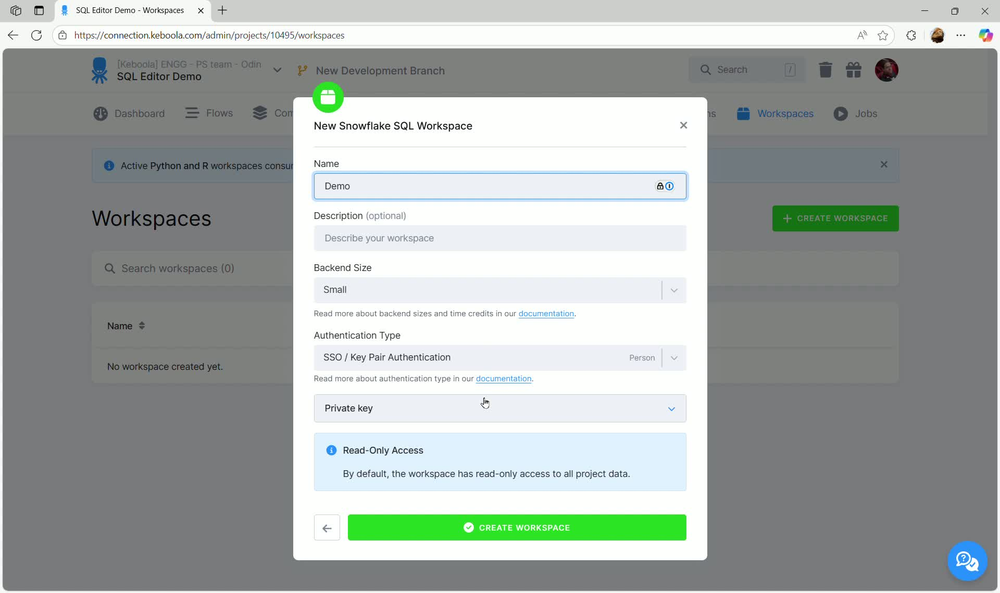

    The workspace will be scheduled and created. Once active, you can access the SQL Editor.

6.  Click on the newly created workspace to view its details.
7.  Click **OPEN SQL EDITOR**.

    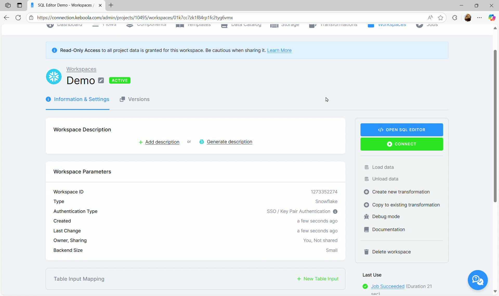

**Result:** the SQL Editor opens on the new workspace.

## Preview a table

**Goal:** the first rows of a table, without writing a query.

To quickly inspect the contents of a table in the Storage Explorer:

1.  Click the three dots next to the desired table (e.g., `account`).
2.  Select **Data preview**.

    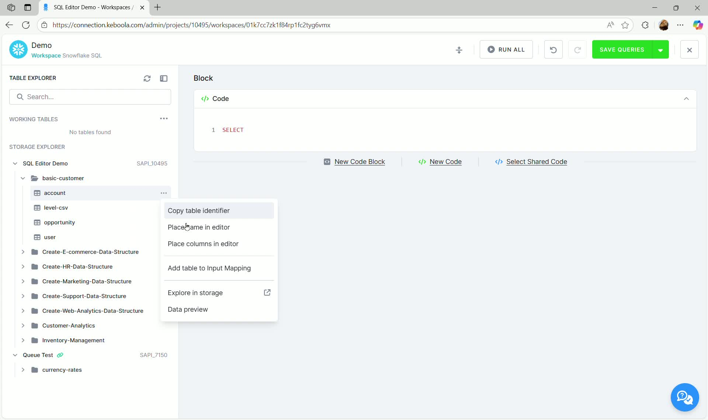

**Result:** this executes a `SELECT * FROM table_name LIMIT 100` query, showing the first rows and metadata in the results pane below.

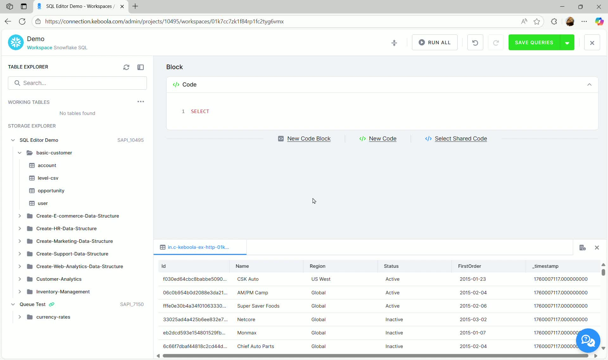

## Run a query

**Goal:** your SQL run against the tables in the workspace, with the result in the pane below the code block.

1.  Insert the table name. Instead of manually typing full table names, you can insert the fully qualified name directly into the editor: click the three dots next to the table name and select **Place name in editor**.

    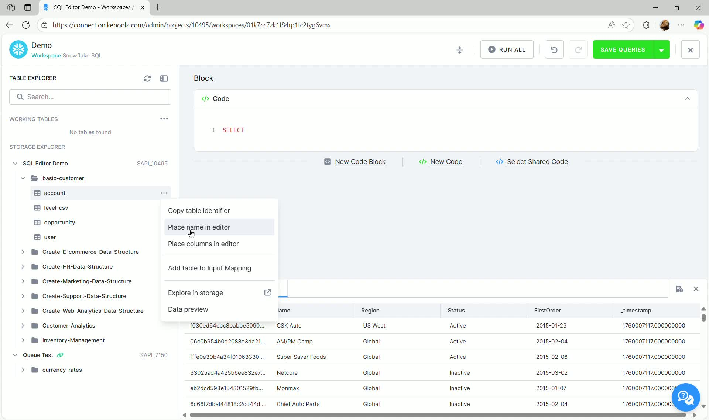

    The editor automatically populates the code block with the table's fully qualified identifier. The exact format depends on your backend; the example below shows Snowflake.

    ```sql
    SELECT * FROM "SAPI_10495"."in.c-keboola-ex-http-01k749e8rrzzs9s7f9p7gbrg"."account";
    ```

2.  Run the query. You can run a query either by clicking the green run icon next to the code block or using the keyboard shortcut **Ctrl + Enter**.

    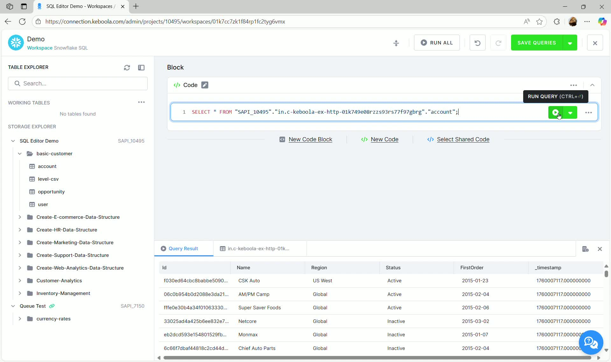

3.  To work with multiple queries, add code blocks using the **+ New Query** button below the existing block, or **+ New Code Block** below the main editor section.

    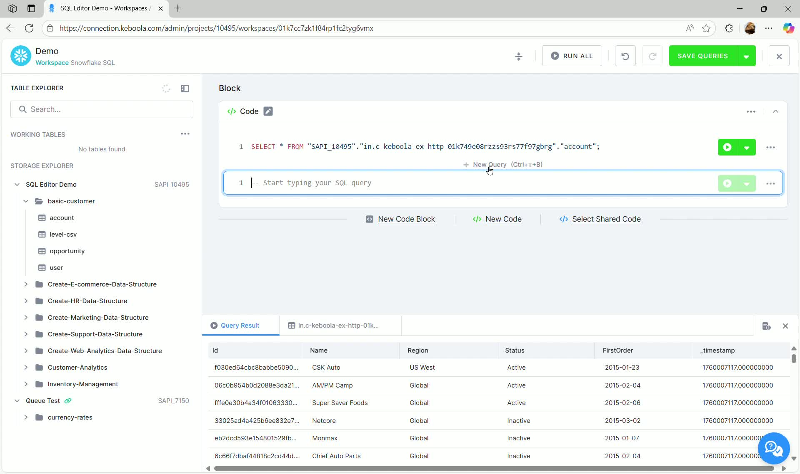

**Result:** the query result appears in the results pane. After executing a query, you can access detailed information about the execution in the results pane by clicking **QUERY DETAILS**.

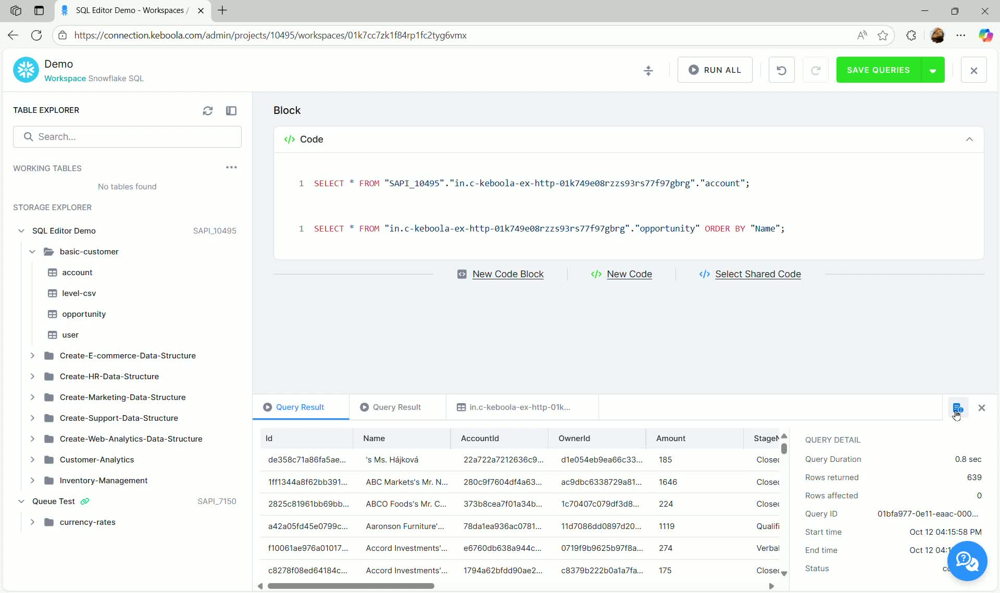

After executing a query, you can view detailed information about previously run queries in the results pane by clicking **QUERY HISTORY**.

## Export a query result

**Goal:** a query result downloaded as a CSV file.

1.  Run the query.
2.  Select **Export Query result** and choose your preferred format:
    *   CSV: standard comma-separated values
    *   CSV (gzip): compressed CSV for large exports

**Result:** your query results are downloaded as a CSV-formatted file.

**Download limit:** Exported files are limited to **100 MB**. If your query result exceeds this size, consider adding a `LIMIT` clause to reduce the row count, filtering the data before export, or using Keboola Storage to access the full dataset.

## Load filtered tables with input mapping

**Goal:** a Storage table loaded into the workspace with a column selection or a filter, the way a transformation would load it.

While the SQL Editor automatically provides read-only access to all tables within the project's Storage (visible in the **Storage Explorer** below the Working Tables section), Input Mapping (IM) is necessary when you need to apply filters, specify specific columns, or set time-based filters before the data is loaded into the workspace database.

Input Mapping is also commonly used when migrating older transformations that rely on input mapping configuration.

1. Locate the desired table in the **Storage Explorer** (e.g., the `account` table under `basic-customer`).
2. Click the three dots next to the table name.
3. Select **Add table to Input Mapping**.

   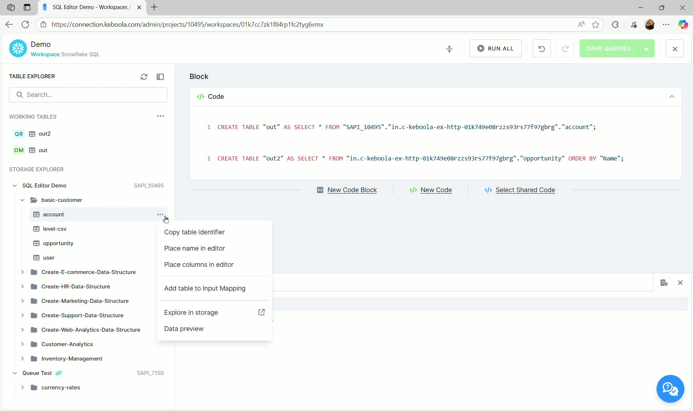

4. The Input Mapping configuration dialog opens:

   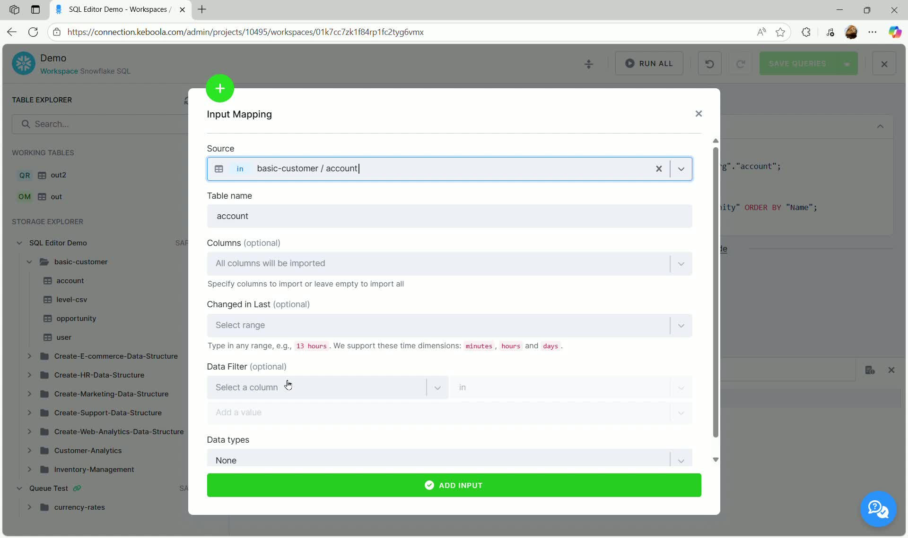

   Here you can define:

   *   **Source:** The source bucket and table (pre-filled).
   *   **Table Name:** The alias used for this table in your SQL queries within the workspace (e.g., `account`).
   *   **Columns (optional):** Specify which columns to import, or leave empty to import all.
   *   **Changed in Last (optional):** Filter the data based on when it was last changed in Storage. This is useful for incremental loads.

       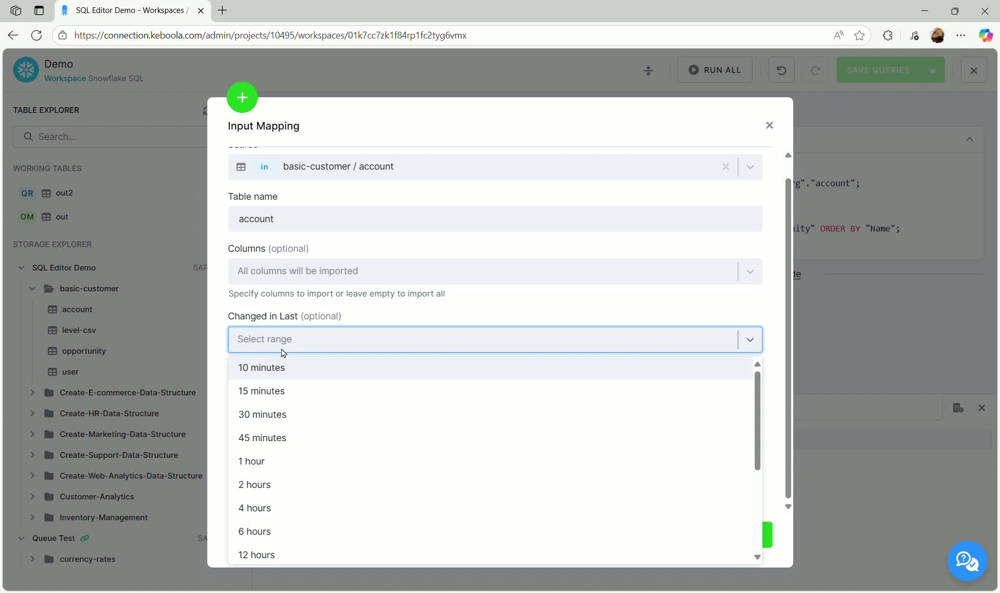

   *   **Data Filter (optional):** Apply column-based filtering using specific values.
   *   **Data Types:** Define column data types (optional).

5. Click **Add Input** to finalize the configuration. The table now appears in the **Working Tables** section marked with **IM** (Input Mapping).

When a table is configured with Input Mapping, it is *not* immediately loaded into the workspace. The configuration merely tells the transformation what to load when it runs.

To query and work with the filtered/mapped data interactively in the editor, you must manually load it:

6. In the **Working Tables** section, locate the Input Mapped table (e.g., `account`).
7. Click the **Load Data** option that appears near the table.

   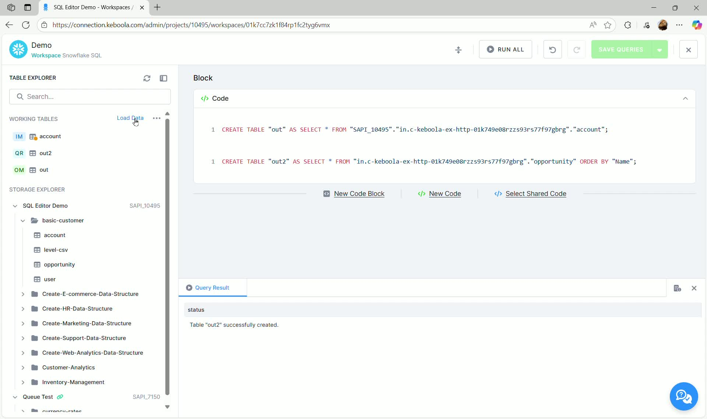

8. Confirm the loading by clicking **Load Latest Data**.

The **Clean workspace before loading** option removes tables and views from the workspace schema but keeps stored procedures and user-defined functions. See [Clean workspace before loading](/workspace/create/#clean-workspace-before-loading).

**Result:** the mapped table is loaded and you can query it. If a table is configured for Input Mapping but not yet loaded, hovering over the table icon will show a warning indicating limited functionality.

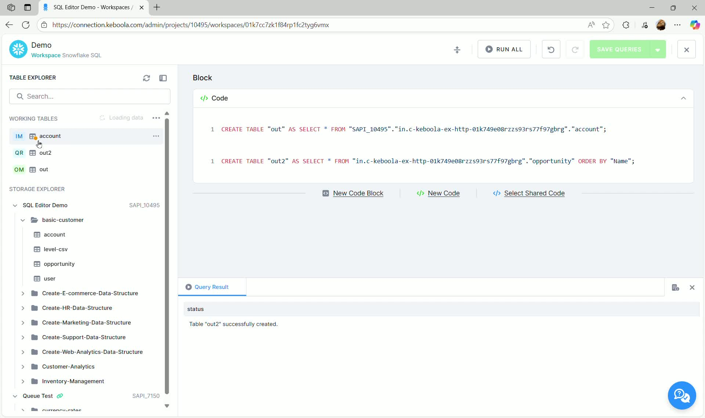

## Save results to Storage with output mapping

**Goal:** a table you created in the workspace mapped to a table in Storage, ready to be saved as a transformation.

The SQL Editor supports creating persistent tables that are saved back into Keboola Storage.

To create a persistent table, you must convert your `SELECT` statements into `CREATE TABLE AS SELECT` statements, specifying a temporary output table name. These tables are automatically created in the workspace schema upon successful execution.

1.  Define a new table using `CREATE TABLE "out" AS SELECT ...`

    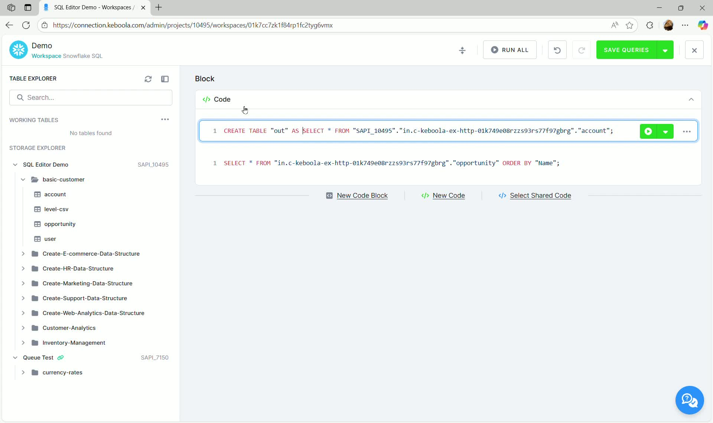

2.  Run the query block. If successful, the new tables (e.g., `out` and `out2`) will appear in the **Working Tables** section.

    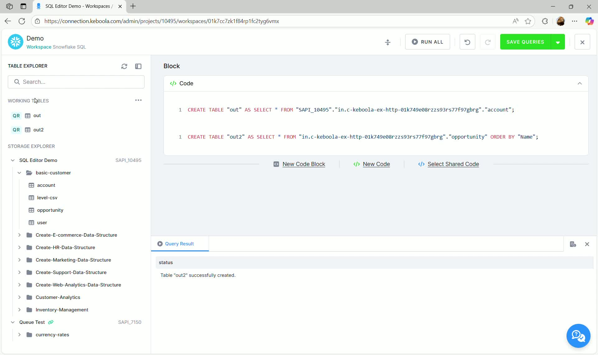

Once temporary working tables are created, you must map them to a destination in Keboola Storage if you want to create a transformation that saves data permanently.

3.  In the Working Tables section, click the three dots next to the temporary table (e.g., `out`).
4.  Select **Add table to Output Mapping**.

    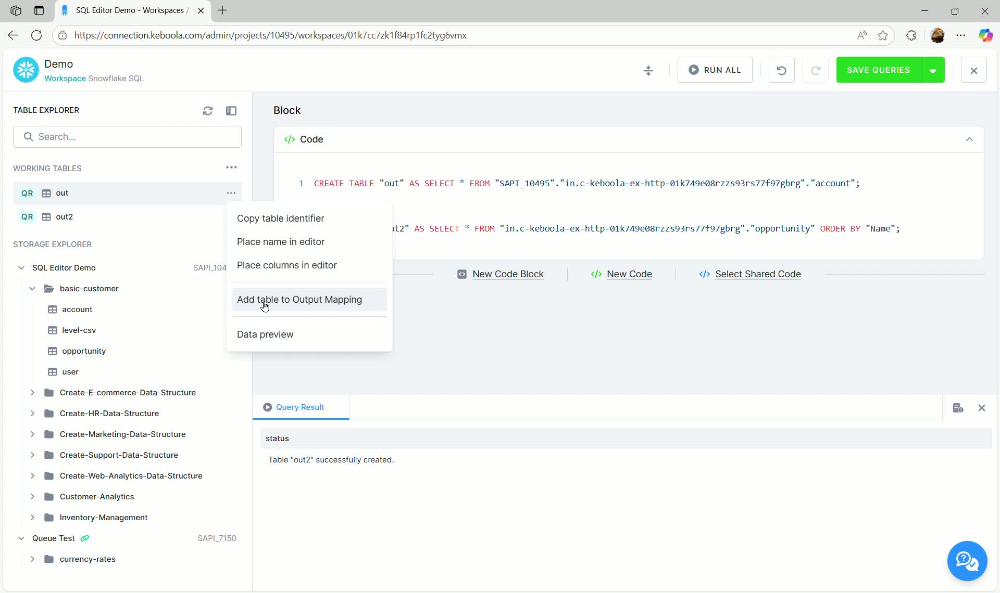

5.  In the Output Mapping dialog, configure the destination bucket and table name in Storage. You can also define the primary key and set incremental loading options.
6.  Click **ADD OUTPUT**.

**Result:** once mapped, the table icon in the Working Tables section changes to **OM** (Output Mapping), confirming it is ready to be saved as a transformation.

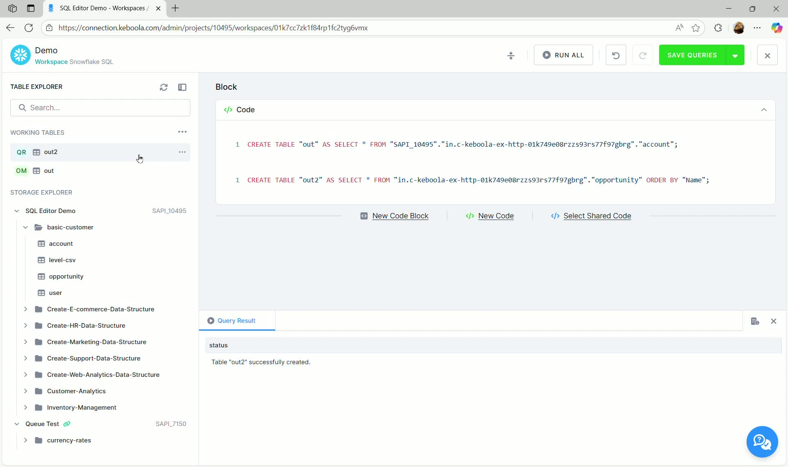

## Write directly to Storage (Direct Mode)

**Goal:** a Storage table the workspace writes to directly, with no copy step.

On Snowflake and BigQuery workspaces, you can skip the copy step altogether and let the workspace write straight
into a Storage table using [Direct Mode output mapping](/transformations/mappings/#direct-mode-output-mapping).

1.  In the **Working Tables** section, click the three dots next to a working table and select
    **Create writable table**.
2.  Set the destination bucket and table name in Storage, and adjust the column definitions and the primary key.
3.  Click **CREATE WRITABLE TABLE**.

**Result:** Keboola creates the Storage table (creating the bucket first if it does not exist yet) and registers it as a
Direct Mode output mapping, which grants the workspace write access to that table. The working table you started
from is used only as the template for the column structure — it is not copied or modified.

The new table shows up in the **Writable tables** section of the Storage Explorer with the **DG** badge, and you
can `INSERT`, `UPDATE`, `DELETE`, or `TRUNCATE` it from your next query. Use the three-dots menu there to remove
the mapping, which also revokes the workspace's write access.

:::caution
In Direct Mode, you are responsible for deduplication, data types, and error handling — Keboola performs no
validation on direct writes. Read the
[good and bad practices](/transformations/mappings/#good-practices) before using it in production.
:::

## Save queries as a transformation

**Goal:** the SQL logic and the output mapping saved as a transformation in your project.

1.  Click **SAVE QUERIES** in the top right corner.

    

2.  Select **Save with description** (or **Save** if no new queries were added).

**Result:** this action saves the SQL code and the output mapping configuration, creating a new Transformation component in your project.

## Reuse shared code

**Goal:** a predefined query from Shared Code in your code block, either copied or linked.

Shared Code allows you to reuse predefined SQL queries across multiple transformations or query blocks. This promotes consistency and simplifies maintenance.

1. In the SQL code editor block, click the **Select Shared Code** link.

   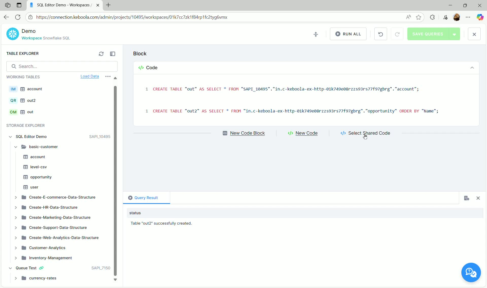

2. In the "Add Shared Code" dialog, select the desired code from the dropdown (e.g., `Aggregate`).

   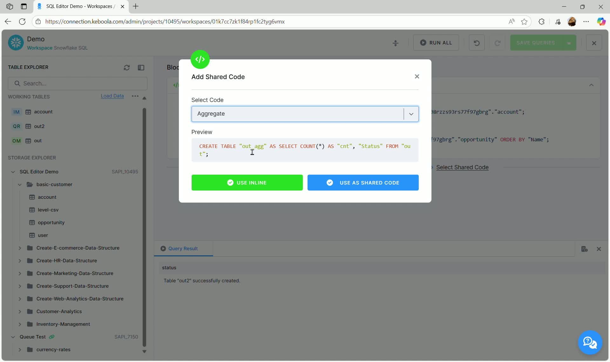

3. Pick one of the two options for using shared code:
   *   **Use Inline:** The SQL text of the shared code is copied directly into your transformation block. You can then freely edit and modify the code locally. This is equivalent to copy-pasting the code.
   *   **Use as Shared Code (Linking):** The code block is linked to the original shared code template.

**Result:** the shared code is in your block. When linking shared code:

*   The code block appears labeled **SHARED CODE**.
*   Any updates made to the original shared code template will automatically propagate to this transformation block.
*   The code within the block is read-only (uneditable), ensuring integrity with the shared template.

If you need to make modifications to the code for a specific transformation, you must use the **Use Inline** option.

**Next:** [Keboola JDBC driver →](/workspace/jdbc-driver/)
